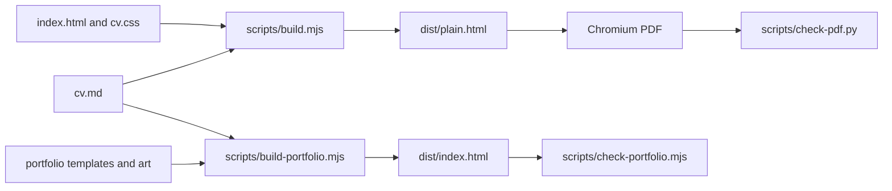

# Mohamed Ashour CV architecture

## Purpose
Publish an illustrated portfolio, a complete plain CV and a selectable, tagged PDF from one professional-content source.

## Scope and Assumptions
Verified on 2026-11-16 against `cv.md`, `portfolio/`, `scripts/`, the plain template and the GitHub Actions workflow. Illustrations are decorative and are not actual hardware or employer architecture.

## System Overview
Node and Marked generate both static HTML modes. The portfolio builder maps the CV's established experience headings to nine always-readable sections and generates inline SVG art. Chromium prints the plain CV to PDF. Only `dist/` is published.

## Architecture Diagram

## Runtime Entry Points
- `npm run build` generates HTML, assets and PDF.
- `npm test` checks portfolio content and browser behavior against `dist/`.
- `python3 scripts/check-pdf.py` verifies the PDF contract.
- Published entry points are `/`, `/plain.html` and `/Mohamed-Ashour-CV.pdf`.

## Architectural Layers
- Canonical content: `cv.md`.
- Portfolio presentation: `portfolio/index.html`, `portfolio/objects.mjs`, and `portfolio/palette.css`. The art module draws role-specific objects without a personal avatar; all SVG is generated at build time without runtime image requests.
- Plain and print presentation: `index.html`, `cv.css`.
- Build and verification: `scripts/build.mjs`, `scripts/build-portfolio.mjs`, `scripts/check-portfolio.mjs`, `scripts/check-pdf.py`.

## External Integrations
Marked parses trusted repository Markdown. Playwright Chromium generates the PDF and runs browser tests. `.github/workflows/deploy.yml` uploads `dist/` and deploys it to GitHub Pages only outside pull-request runs. Profile and email links navigate externally; the homepage itself fetches no external resources.

## Core Data Flow (Current)
The builder reads `cv.md`. Canonical Markdown sections become role details and the plain CV. Role IDs and short navigation labels are an explicit presentation mapping, not a second copy of professional facts. The homepage includes generated SVG/CSS inline. The plain CV and its stylesheet feed the PDF printer. A validated role query parameter lets Plain CV return to the section being read. Passive scroll events update the current-role indicator and return target; native anchor links remain optional shortcuts and work without JavaScript.

## Module Ownership Boundaries
The portfolio builder owns the mapping from Markdown headings to sections and fails if a mapped role is absent or an extra role is introduced. The art module owns only decorative pixel geometry. PDF generation uses the plain template so portfolio graphics do not affect page count, tags or reading order. Experimental design files are outside the production dependency graph.

## Architecture Change Protocol
Keep `cv.md` canonical and the plain-template content marker intact. Run the build, browser tests and PDF check for publishing changes. Update explicit role mappings when experience headings change. Preserve the PDF URL and verify any navigation changes with JavaScript disabled and reduced motion.

## Future Clarifications
Chromium layout checks run in CI, including enlarged text and mobile scene placement. A local Firefox layout audit passed; WebKit was unavailable due to host libraries. Safari and real screen-reader testing remain adoption checks. Reverting the homepage build to the plain template restores the previous presentation without changing content or hosting.
